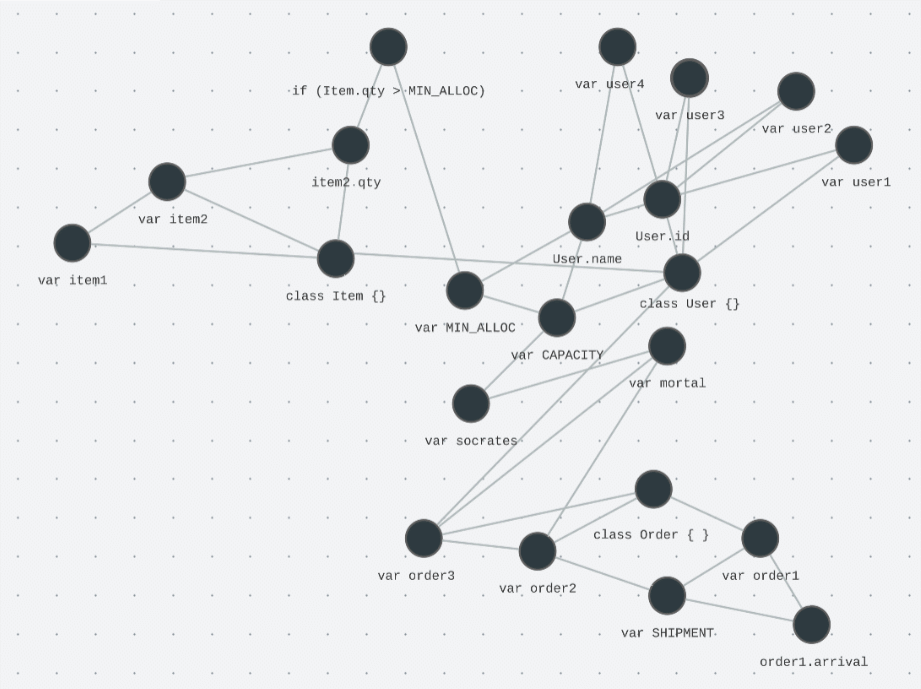

<h1 align="center">Nucleoid</h1>
<p align="center">
  <a href="https://www.apache.org/licenses/LICENSE-2.0"></a>
  <a href="https://huggingface.co/nucleoid"></a>
  <a href="https://discord.gg/wN49SNssUw"></a>
</p>


<p align="center">
  <b>Synthesized Logic Language for World Models 🌱🐋🌍</b>
</p>

<br/>

⚡ Nucleoid is designed with a minimum-token syntax for logic representation and a declarative execution model, eliminating the need for LLMs to manually manage control flow, state propagation, and other imperative constructs. In addition, Nucleoid is a next-generation logic programming language built on structured objects and their relationships, extending the traditional Knowledge Graph.

- **Near-Deterministic:** Structured, reliable reasoning.
- **Minimum-Token Syntax:** Token-efficient declarative syntax.
- **Logic Graph:** Executable knowledge graph.

<br />

https://github.com/user-attachments/assets/3b5a5fa8-9309-473f-ae18-f55e0f63d4da

<br />

## Quick Start :zap:

Install the CLI from crates.io:

```console
cargo install nucleoid
```

Start the interactive CLI from any directory and teach it that Socrates is
mortal:

```console
> class Human(name: str):
..    this.name = name
..
> $Human.mortal = true
> socrates = Human("Socrates")
> socrates.mortal
true
```

Interactive body lines are prefilled with indentation after the `..` prompt.
Tab inserts four spaces; use Backspace to dedent and submit a blank line to run
the complete block. Piped input is not reindented and must include its own
whitespace.

---

# Design Theory 📐

<p align="center">
  
</p>

## Language Reference

[**docs/README.md**](docs/README.md) is the language reference: statements and state, variables and dependencies, expressions, types and instances, properties, class-level rules, blocks and scope, control flow, functions, transactions, built-in objects, live graph reasoning, error messages, and a syntax summary.

It is assembled from the NUC documents in [`docs/`](docs), indexed by [NUC 0](docs/nuc-0000.md) with the conventions in [NUC 1](docs/nuc-0001.md). `nucleoid.spec.md` is normative; where the two disagree, the specification wins.

[**docs/examples.md**](docs/examples.md) covers the same ground as complete programs, each one runnable as written.

The isolated [NUC 47 revision](docs/nuc-0047.md) uses ordinary class headers:
`class Point(x, y)` accepts positional, named and positional-then-named calls.
`Point(y=4, x=3)` binds labels without caller assignments; explicit grouped
assignments retain positional effects. The former star header is removed.
See the [paired reference example](docs/README.md#default-named-constructors).
Ordinary function/method calls retain assignment-expression behavior.

A Nucleoid program is a set of statements that remain true. An assignment is not an instruction that runs once and finishes, it is a relationship the runtime records and maintains.

**An assignment states a relationship, not a result**

```nuc
a = 1
b = a + 2

a = 3

assert(b, 5)
```

`b` is never stale. It is the sum of `a` and `2`, so changing `a` brings it up to date, and the same holds for properties, class-level rules and everything else the reference covers.

**Compound assignments keep their reactive relationships**

```nuc
amount = 10
step = 2
amount += step
assert(amount, 12)
step = 3
assert(amount, 15)
```

The compound operators `+=`, `-=`, `*=`, `/=`, and `%=` are short
spellings of `target = target op (expression)`, not a new mutation mode.
Plain names and dotted paths are supported; old assignment syntax remains
valid. [NUC 13](docs/nuc-0013.md) passed independent per-case evaluation.
The crate is now `2.0.0` because the new public lexer token variants affect
downstream exhaustive Rust matches; existing Nucleoid programs remain valid.

**Empty types need no placeholder body**

```nuc
class Entity
entity1 = Entity()
$Entity.enabled = true
assert(typeof Entity, List)
assert(entity1.enabled, true)
assert(Entity.length, 1)
```

A bare class header is equivalent to an indented pass-only body. Optional
parameters keep their existing binding behavior and do not create properties
automatically. Nonempty bodies and inheritance retain the colon syntax.
[NUC 14](docs/nuc-0014.md) specifies the accepted syntax and its independent
per-case evaluation.

**Parent constructors omit empty call parentheses**

```nuc
class Counter:
    def init():
        this.total = 1

class Counted: Counter
    def init():
        super
        this.total = this.total + 1

counted = Counted()

assert(counted.total, 2)
```

Bare `super` is the zero-argument expression `super()`, running the parent
constructor on the same instance and returning `null`. Calls with arguments
still use `super(arguments...)`. [NUC 16](docs/nuc-0016.md) describes this
candidate shorthand; its proposal status remains Draft.

**Object fields reuse their identifier names**

```nuc
amount = 4
label = "meter"
reading = { amount, label }

assert(reading.amount, 4)
assert(reading.label, "meter")

amount = 6

assert(reading.amount, 6)
```

In this isolated [Draft NUC 17](docs/nuc-0017.md) candidate, an ordinary
identifier field in an object expression is shorthand for `name: name`.
Explicit fields still mix with shorthand; quoted and numeric keys still need
a value. The existing AST, canonical expanded source, scope lookup, dependencies,
snapshots, and transactions are unchanged. This prototype does not change
the accepted language until independent evaluation and caller integration.

**Single input named arrows omit parameter parentheses**

```nuc
def square amount => amount * amount

assert(square(3), 9)
assert(square(4), 16)
```

[NUC 18](docs/nuc-0018.md) specifies parameter-parenthesis omission for named
arrow definitions and methods with exactly one untyped ordinary identifier
parameter. Nullary definitions and calls still use parentheses; the optional
untyped and typed/mixed multiple-parameter arrow spellings are
demonstrated below. `def square(amount) => amount * amount` remains valid.
The body, binding, reactivity, snapshots, receivers and initializer behavior
remain those of [NUC 12](docs/nuc-0012.md).

**Single input block definitions omit parameter parentheses**

```nuc
def square amount =>
    amount * amount

assert(square(3), 9)
assert(square(4), 16)
```

[NUC 19](docs/nuc-0019.md) specifies the same optional single-untyped-identifier
spelling before an indented colon suite, including methods and `init`.
The sole-return example above uses NUC32's equivalent indented arrow;
`def square amount:` or `def square(amount):` with explicit
`return amount * amount` remains valid. The colon must lead to
a real indented body; inline/brace suites, empty and typed/mixed multiple-parameter
block signatures retain their parentheses. The optional untyped multiple-parameter
indented spelling is demonstrated below. Typed single-parameter indented blocks
have the separate optional spelling below. Block returns, parameter binding, live
dependencies and runtime behavior are unchanged.

**Typed single input named arrows omit parameter parentheses**

```nuc
source = 3

def double amount: int => amount * 2

result = double(source)

assert(result, 6)

source = 5

assert(result, 10)
```

[NUC 20](docs/nuc-0020.md) specifies only the immediate
single-identifier typed-arrow header. `def double(amount: int) => amount * 2`
remains valid with identical parameter/type metadata and named return-block
behavior. Annotations retain their existing handling, not new variable lookup
or type enforcement. Typed bare inline/braced blocks and logical header breaks
are not added. The separate NUC29 extension below adds only typed/mixed
multiple-parameter arrows; calls and NUC18/19 spellings are unchanged.

**Numeric clamping keeps values within live bounds**

```nuc
reading = 12
upper = 10

bounded = Math.clamp(reading, 0, upper)

assert(bounded, 10)

reading = 3

assert(bounded, 3)

upper = 2

assert(bounded, 2)
```

[NUC 21](docs/nuc-0021.md) specifies static numeric clamping as the ordered
composition `Math.min(Math.max(value, lower), upper)` with existing numeric
coercion. Reversed bounds yield the upper bound, numeric `NaN` propagates,
and omitted inputs supply numeric `NaN`. Extra argument expressions still run
left to right and participate in the existing undefined gate. The proposal
header records its status; no range-validation error or callable Math method
reference is introduced.

**Numeric interpolation blends live values**

```nuc
start = 0
end = 10
weight = 0.5

mixed = Math.lerp(start, end, weight)

assert(mixed, 5)

end = 20

assert(mixed, 10)

weight = 0.25

assert(mixed, 5)
```

[NUC 22](docs/nuc-0022.md) specifies static `Math.lerp(start, end, weight)`;
its header records its status. After intrinsic numeric conversion, it computes
`end - start`, multiplies by `weight`, then adds `start`, using ordinary ordered
arithmetic without fused operations, endpoint shortcuts or weight clamping.
Negative or greater-than-one weights extrapolate; special values and rounding
follow that exact formula. Omissions supply numeric `NaN`; every supplied
expression runs once left to right, including extras and the existing undefined
gate. Live-null/deferred assignment contexts, shadowing and unsupported Math
method-value reads remain unchanged.

**Unit-interval saturation normalizes live progress**

```nuc
# Unit-interval saturation normalizes live progress

ratio = 0.3
progress = Math.saturate(ratio)

assert(progress, 0.3)

ratio = 1.5

assert(progress, 1)

ratio = -0.5

assert(progress, 0)
```

[NUC 23](docs/nuc-0023.md) specifies static `Math.saturate(value)` as exactly
ordered `Math.clamp(value, 0, 1)` through
the accepted min/max folds, with intrinsic numeric conversion, not host range
validation or endpoint shortcuts. Omission produces numeric `NaN`; extra
expressions still run once left to right and retain reads, effects and the
existing undefined gate. Live-null/deferred handling, rollback, namespace
shadowing and unsupported method-value reads remain unchanged. The normative
contract is [Reactive unit-interval saturation](nucleoid.spec.md#reactive-unit-interval-saturation).

**Typed block definitions preserve live bounded progress**

```nuc
# Typed block definitions preserve live bounded progress

ratio = 0.3

def normalize amount: ArbitraryType =>
    Math.saturate(amount)

progress = normalize(ratio)

assert(progress, 0.3)

ratio = 1.5

assert(progress, 1)

ratio = -0.5

assert(progress, 0)
```

[NUC 24](docs/nuc-0024.md) describes the optional single typed parameter spelling
before a real indented suite. `def normalize(amount: ArbitraryType):` with the
same body remains valid. The immediate name/colon/annotation/colon prefix and
real indent preserve the full parameter metadata and named block AST.
Annotations introduce no lookup or runtime type constraint. Header-line breaks,
inline/braced bare suites and other parameter/type forms are not added; calls,
NUC18/19/20 spellings, block returns and live dependencies are unchanged.

**Logical compound assignments preserve short-circuiting**

```nuc
def fail():
    throw "UNREACHABLE"
enabled = true
enabled ||= fail()
assert(enabled, true)
disabled = false
disabled &&= fail()
assert(disabled, false)
```

[Accepted NUC 26](docs/nuc-0026.md) defines optional `&&=` and `||=`.
They lower exactly to `target = target && (rhs)` and
`target = target || (rhs)`, not JavaScript-style conditional writes.
A standing assignment installs its relationship even when logical evaluation
skips the right operand. Existing `=`, `&&`, `||`, `and`, `or`, and arithmetic
compounds remain supported; snapshots, dependencies and rollback are unchanged.
The public lexer enum additions require a human-owned API semver decision;
this revision changes no project version.

**Named arrows can omit parentheses around multiple parameters**

```nuc
def add left right => left + right
assert(add(2, 3), 5)
def scaled left right factor => (left + right) * factor
assert(scaled(2, 3, 4), 20)
```

[Accepted NUC 27](docs/nuc-0027.md) adds only a complete
comma-separated list of two or more untyped ordinary identifiers immediately
followed by `=>` on the same logical header line, including methods and `init`.
`def add(left, right) => left + right` remains valid and exactly equivalent.
Trailing bare commas, bare inline/braced blocks, defaults,
destructuring, rest parameters and return annotations are not added.
Typed/mixed arrow lists have the separate NUC29 spelling below.
No logical newline, semicolon or comment-induced break is skipped. Calls retain
their parentheses and anonymous arrows retain their existing grammar; the
single-parameter typed and block alternatives above remain unchanged.

**Indented blocks can omit parentheses around multiple parameters**

```nuc
def add left right =>
    left + right
assert(add(2, 3), 5)
```

[NUC 28](docs/nuc-0028.md) adds the optional spelling of
`def add(left, right):` with the same indented body, including methods and `init`.
The complete comma-separated list contains two or more untyped ordinary
identifiers on one logical header line. After the colon require an immediate
newline or indent and a real indent after only normal newline/semicolon layout;
a colon immediately followed by a semicolon does not qualify. Blank/comment
lines before a genuine body keep their existing grammar.
NUC30 separately adds typed/mixed multiple indented headers below; NUC28's
identifier-only forms remain unchanged. Inline/braced bare suites, trailing bare
commas and logical breaks within the header remain unsupported. Parenthesized
forms, arrows, single-parameter guards and calls are unchanged. Block returns,
scope, receivers, live relationships, snapshots and rollback retain the
parenthesized behavior; there is no implicit last-expression return.

**Typed multiple parameter named arrows can omit parentheses**

```nuc
def add left: int, right: int => left + right
assert(add(2, 3), 5)
```

- [NUC 29](docs/nuc-0029.md) adds this optional arrow spelling;
  `def add(left: int, right: int) => left + right` remains
  valid and exactly equivalent, including methods and `init`.
- Require at least two ordinary identifier parameters, with at least one
  existing `: Identifier` annotation for the new typed/mixed forms. Untyped
  multiple lists retain NUC27 behavior; annotations stay metadata, not runtime
  type checks. Mixed lists may annotate any parameter.
- The complete comma-separated header must immediately end in `=>`, without
  logical breaks or skipped separators. NUC29 does not itself add blocks;
  NUC30's separate typed/mixed indented spelling follows below. Bare inline/braced
  suites, trailing bare commas, new parameter/type grammar and call-site omission
  remain unsupported. Single guards and NUC28 untyped blocks are unchanged.
- Binding, named return-block lowering, expression bodies, receivers,
  reactivity, snapshots, graph dependencies and rollback remain unchanged.

**Typed multiple parameter blocks can omit parentheses**

```nuc
def add left: int, right: int =>
    left + right
assert(add(2, 3), 5)
```

- [NUC 30](docs/nuc-0030.md) describes the optional spelling of
  `def add(left: int, right: int):` with the same real indented body, including
  methods and `init`. Mixed headers such as `def add left: int, right:` also
  preserve the complete named block and ordered annotation metadata.
- Require at least two ordinary identifier parameters, with at least one
  existing `: Identifier` annotation for the new forms. Entirely untyped lists
  remain NUC28 behavior; annotations introduce neither lookup nor type checking.
- Scan the complete header without consuming tokens or skipping logical breaks.
  The suite colon must immediately lead to a newline or indent and a real indent
  after only normal newline/semicolon layout; `:;` never qualifies.
  A final untyped parameter's colon belongs to the suite, not an annotation.
- Parenthesized forms, NUC24 single typed blocks, NUC28 untyped blocks, NUC29
  arrows and calls remain unchanged. Bare inline/braced suites, trailing commas,
  new type/parameter grammar and return annotations are not added.
- Block returns, local shadowing, receivers, reactive inputs, live aliases,
  definition snapshots, redefinition and rollback keep the parenthesized
  behavior, with no implicit final-expression return.

**Named source loops can bind it implicitly**

```nuc
class Task
task = Task()
task.done = false
for Task:
    it.done = true
assert(task.done, true)
```

- Accepted [NUC 31](docs/nuc-0031.md) specifies optional `for NAME:` with a
  genuine indented body as exactly `for it of NAME:` with that same body.
  `NAME` is one ordinary identifier; the body binds each visited instance to
  local `it`, restoring any outer binding afterward.
- The source is evaluated once: class populations and lists visit only current
  registered typed instances in order. Primitives, null elements and plain
  objects in lists are skipped; this is not general array iteration or a
  standing rule. A named noniterable source raises the existing TypeError.
- Require the immediate identifier/colon header, then a newline or indent and
  a real indent after only normal newline/semicolon layout. No `:;`,
  inline/braced/missing-indent or expression-source shorthand is added.
- Explicit `for variable of expression` and `for variable in expression`
  remain valid with their existing arbitrary expressions and suite forms.
  Nested scopes, receivers, returns, snapshots, graphs and rollback are unchanged.

Reasoning stays live too: `why b` explains its dependencies, and `affects a`
reports its downstream impact. Both update when relationships are rewritten,
added, or removed, even if their values stay the same. The implemented stages of
[NUC 11](docs/nuc-0011.md) cover selections, pipelines, and structural subscriptions;
its later stages remain proposals.

Every example in the reference is executable: `tests/reference.md` is its executable form and runs under `cargo test`, as do the snippets on this page.

---

<table>
  <tr>
    <td>
      Welcome! I’ve been expecting you—"Skynet was gone. And now one road has become many." 🌐
      <br/>
      <br/>
      The future is building up! World Models are now an emerging field within AI communities and marks a crucial milestone on the journey to AGI. Unfortunately, existing symbolic AI and knowledge graphs lack advancement in today's AI landscape. Nucleoid is revolutionizing knowledge graphs with declarative, logic-based, contextual runtime, which can be integrated with ANNs to lay a robust foundation for the next leap forward imao.
      <br/>
      <br/>
      <p align="right">
        Can Mingir&nbsp;
        <br/>
        <a href="https://github.com/canmingir">@canmingir</a>
      </p>
    </td>
  </tr>
</table>

---

## Neuro-Symbolic AI


A world model is what a system knows about a domain: which entities exist, how they relate, which rules hold across all of them, and what follows once something changes. In an LLM that model is implicit, spread across the weights, and that is where hallucination begins, because a model that cannot be inspected cannot be corrected and cannot be held to its own rules. Neuro-Symbolic AI is how the model is made explicit, and it is why the two components below are complementary rather than competing.

Neuro-Symbolic AI is an approach that integrates the strengths of both neural networks and symbolic AI to create systems that can learn from data and also reason logically. By combining these two components, Neuro-Symbolic AI aims to leverage the intuitive, pattern-recognition capabilities of neural networks along with the logical, rule-based reasoning of symbolic AI. This integration offers a more holistic AI system that is both adaptable and able to explain its decisions, making it suitable for complex decision-making tasks where both learning from data and logical reasoning are required. Here’s how it breaks down:

### Neural Networks: The Learning Component

Neural networks in Neuro-Symbolic AI are adept at learning patterns, relationships, and features from large datasets. These networks excel in tasks that involve classification, prediction, and pattern recognition, making them invaluable for processing unstructured data, such as images, text, and audio. Neural networks, through their learning capabilities, can generalize from examples to understand complex data structures and nuances in the data.

### Symbolic AI: The Reasoning Component

The symbolic component of Neuro-Symbolic AI focuses on logic, rules, and symbolic representations of knowledge. Unlike neural networks that learn from data, symbolic AI uses predefined rules and knowledge bases to perform reasoning, make inferences, and understand relationships between entities. This aspect of AI is transparent, interpretable, and capable of explaining its decisions and reasoning processes in a way that humans can understand.

<br/>

<p align="center">
  
</p>

### World Models: The State Component

Neural networks learn and symbolic AI reasons, but reasoning needs something to reason over, and that is the world model: the entities, relationships and rules a system currently holds to be true. In Nucleoid the model is not a passive knowledge base that is read from and written to, it is a logic graph that the runtime keeps true on its own. A rule stated over a type holds for every instance of it, including instances created long afterwards, and a change to any value propagates to everything derived from it, so the model is never left holding a fact together with its own stale consequence.

Rules also decide which worlds are admissible. A statement and every rule it triggers form a single transaction, and if any rule rejects the change, the transaction is rolled back and the state is exactly as it was, so an update that would contradict the model is never partially applied. A world model built this way cannot drift into a state that violates its own laws.

This is what makes the model usable by a language model. It is written incrementally, one statement at a time, in a syntax that costs few tokens, and it can be queried long after it was written, by another session or another model, because the meaning lives in the graph rather than in the context window.

## Declarative Language: 6GL Programming Language

Nucleoid is a 6GL programming language, and Nucleoid acts as the ubiquitous language in Neuro-Symbolic AI for specifying the desired outcomes of a program without detailing the procedural methods to achieve these outcomes. This type of language is essential for articulating logical rules, constraints, and relationships that underpin symbolic reasoning within these systems. It supports the formulation of structured knowledge bases and facilitates logical reasoning tasks, enabling systems to deduce, infer, and respond to queries based on established rules. Moreover, declarative languages are instrumental in integrating the outputs of neural networks into symbolic reasoning frameworks, marrying data-driven learning with rule-based logic. Their widespread use enhances the transparency, explainability, and modularity of AI systems, while also boosting their efficiency in domains heavily reliant on rule-based operations.

### Declarative Logic in Symbolic Reasoning

Declarative logic is a subset of declarative programming, a style of building programs that expresses the logic of a computation without describing its control flow. In declarative logic, you state the facts and rules that define the problem domain. The runtime environment or the system itself figures out how to satisfy those conditions or how to apply those rules to reach a conclusion. This contrasts with imperative programming, where the developer writes code that describes the exact steps to achieve a goal.

Symbolic reasoning refers to the process of using symbols to represent problems and applying logical rules to manipulate these symbols and derive conclusions or solutions. In AI and computer science, it involves using symbolic representations for entities and actions, enabling the system to perform logical inferences, decision making, and problem-solving based on the rules and knowledge encoded in the symbols.

By integrating Nucleoid into Neuro-Symbolic AI, the system benefits from enhanced interpretability and reliability. The declarative logic and rules defined in Nucleoid provide clear explanations for the AI's decisions, making it easier for users to understand and trust the system's outputs. Furthermore, the explicit reasoning capabilities help ensure that decisions are made based on logical principles, adding a layer of reliability and consistency to the AI's behavior.

<p align="center">
  
</p>

### Plasticity in Neuro-Symbolic AI

In the realm of Neuro-Symbolic AI, *Plasticity* is an important element for the system's ability to modify and optimize its connections in response to new information. This concept is inspired by neuroplasticity in biological brains, where neurons can strengthen or weaken their connections based on activity, enabling learning and memory.

1. **Dynamic Knowledge Base**: Neuro-Symbolic AI systems dynamically update their knowledge base as they encounter new scenarios or corrections to their previous knowledge. This continuous updating process allows the systems to remain relevant and accurate over time.
2. **Adaptive Logic and Reasoning**: The AI system can modify its symbolic rules and reasoning strategies to better match observed data or outcomes, enhancing its decision-making and problem-solving abilities.
3. **Generalization and Specialization**: Through plasticity, the system can generalize from learned experiences to new, unseen scenarios or specialize in certain domains by fine-tuning its parameters or rules based on specific data inputs.

The idea of plasticity in AI, especially in logic-based systems like those in Neuro-Symbolic AI, enhances the capability of machines to not only perform tasks based on fixed rules but also to evolve those rules and adapt their reasoning over time, much like the cognitive flexibility of living things.

Learn more at [nucleoid.com/docs/get-started](https://nucleoid.com/docs/get-started)

## Nucleoid's Taxonomy

Nucleoid is an implementation of symbolic AI for declarative (logic) programming at the runtime. As mentioned, the declarative runtime environment manages the state and stores each transaction in the built-in data store by declaratively rerendering statements and building the knowledge graph (base) as well as an execution plan.

<p align="center">
  
</p>

The declarative runtime isolates a behavior definition of a program from its technical instructions and executes declarative statements, which represent logical intention without carrying any technical detail. In this paradigm, there is no segregation regarding what data is or not, instead approaches how data (declarative statement) is related with others so that any type of data including business rules can be added without requiring any additional actions such as compiling, configuring, restarting as a result of plasticity. This approach also opens possibilities of storing data in the same box with the programming runtime.

<div align="center">
  <table>
    <tr>
      <th>
        
      </th>
      <th>
        
      </th>
    </tr>
  </table>
</div>

In short, the main objective of the project is to manage both of data and logic under the same runtime. The declarative programming paradigm used by Nucleoid allows developers to focus on the business logic of the application, while the runtime manages the technical details.This allows for faster development and reduces the amount of code that needs to be written. Additionally, the sharding feature can help to distribute the load across multiple instances, which can further improve the performance of the system.

**Named arrows can indent a single expression**

```nuc
def square value =>
    value * value
assert(square(4), 16)
```

[NUC 32](docs/nuc-0032.md) specifies an optional genuinely indented expression
after the existing named `=>`. It is exactly the colon suite containing
`return value * value`; existing inline arrows and colon suites remain valid.
It does not add an arbitrary statement suite or an implicit final-statement
return, and nullary definitions still require `()`.
Earlier sole-return block examples above use this equivalent layout where
applicable; existing colon suites, including multi-statement bodies, are
unchanged alternatives.

**Cubic smoothstep keeps input changes live**

```nuc
value = 0.25
unit = Math.saturate(value)
eased = Math.smoothstep(0, 1, value)
assert(unit, 0.25)
assert(eased, 0.15625)
value = 0.75
assert(eased, 0.84375)
```

- [Accepted NUC 33](docs/nuc-0033.md) defines static
  `Math.smoothstep(lower, upper, value)`, with bounds before the value.
- The independent `unit` control remains live; the intrinsic normalizes and
  clamps before applying the ordered cubic, retaining existing special-value,
  deferred-read and transactional behavior.

**Indented else suites keep live inputs concise**

```nuc
enabled = false
raw = 2
if enabled:
    display = raw
else
    display = raw + 1
assert(display, 3)
enabled = true
assert(display, 2)
raw = 5
assert(display, 5)
```

- Accepted [NUC 34](docs/nuc-0034.md) permits this optional final-`else` spelling
  only before a real indented body. `else:` remains valid and equivalent.
- This legacy control deliberately retains its condition colon.
  [NUC 49](docs/nuc-0049.md) also permits omission for genuine-indented
  `if`/`else if` suites; inline, semicolon-separated and braced alternatives
  still require their accepted colons. A header-line semicolon cannot qualify.
- Nested branch association, live inputs, scope, returns and rollback are
  unchanged. Strings and comments containing `else:` are not rewritten.

**Quintic smootherstep keeps input changes live**

```nuc
value = 0.25
unit = Math.saturate(value)
eased = Math.smootherstep(0, 1, value)
assert(unit, 0.25)
assert(eased, 0.103515625)
value = 0.75
assert(eased, 0.896484375)
```

- Accepted [NUC 35](docs/nuc-0035.md) adds static
  `Math.smootherstep(lower, upper, value)` beside unchanged cubic
  `Math.smoothstep`. The independent `unit` control remains live.
- Normalize and clamp before the exactly ordered quintic; do not clamp its
  result, which can round beyond the unit interval. Existing numeric coercion,
  special values, deferred reads, argument effects and rollback are preserved.

**Floor fractional parts keep negative inputs live**

```nuc
value = -1.25
whole = Math.floor(value)
fraction = Math.fract(value)
assert(whole, -2)
assert(fraction, 0.75)
value = 3.5
assert(fraction, 0.5)
```

- Accepted [NUC 36](docs/nuc-0036.md) adds static `Math.fract(value)` as
  intrinsic numeric conversion followed by floor and subtraction, retaining
  the independent `whole` control and accepted floor-subtraction spelling.
- Negative fractions subtract floor, not truncation. Tiny negative inputs can
  round to exactly one, so the result is not promised strictly in `[0, 1)`.
  Numeric coercion, ignored-extra effects/reads, deferral and rollback remain.

**Named arrow parameters can omit every comma**

```nuc
def add left right => left + right
assert(add(2, 3), 5)
def scaled left right factor => (left + right) * factor
assert(scaled(2, 3, 4), 20)
```

- [NUC 37](docs/nuc-0037.md) adds optional all-comma-free
  bare named arrows with at least two untyped ordinary identifiers on one
  logical header line. The comma-bearing and parenthesized forms remain
  valid. Typed/mixed lists still need commas; the separate NUC40 below
  adds the wholly untyped, genuinely indented colon-suite counterpart.

**Inverse interpolation keeps live inputs unclamped**

```nuc
start = 0
end = 8
sample = 2
weight = Math.inverseLerp(start, end, sample)
assert(weight, 0.25)
sample = 12
assert(weight, 1.5)
end = 16
assert(weight, 0.75)
```

- Accepted [NUC 38](docs/nuc-0038.md) adds only static
  `Math.inverseLerp(start, end, value)`, the unclamped ordered composition
  `(value - start) / (end - start)` with intrinsic numeric conversion.
- Descending ranges and results outside `[0, 1]` are intentional. Equal
  endpoints, nonfinite values and span overflow follow separate subtraction,
  subtraction and division, without endpoint shortcuts or scaling.
- The accepted arithmetic spelling remains available. Ignored-extra reads,
  effects, strict failures, live-null deferral and rollback remain unchanged;
  the authoritative [contract](nucleoid.spec.md#reactive-inverse-interpolation)
  defines the complete numeric and compatibility rules.

**Range remapping keeps live values unclamped**

```nuc
start = 0
end = 8
targetStart = 0
targetEnd = 100
sample = 2
mapped = Math.remap(start, end, targetStart, targetEnd, sample)
assert(mapped, 25)
sample = 12
assert(mapped, 150)
end = 16
assert(mapped, 75)
```

- Accepted [NUC 39](docs/nuc-0039.md) adds only static
  `Math.remap(start, end, targetStart, targetEnd, value)`, the unclamped numeric
  composition of accepted inverse interpolation and interpolation.
- Keep six separate ordered operations, with no rescaling, range ordering,
  endpoint shortcuts or fused arithmetic. Both ranges may descend.
- The accepted nested spelling remains available. Its target arguments run
  before inner source arguments; the new call instead evaluates its listed
  five arguments left to right. Pure-read paired cases preserve behavior.
- Ignored-extra effects/reads, live-null deferral and rollback use unchanged
  machinery; the authoritative
  [contract](nucleoid.spec.md#reactive-range-remapping) gives the full rules.

**Indented blocks can omit every parameter comma**

```nuc
def add left right:
    return left + right
left = 2
right = 3
total = add(left, right)
assert(total, 5)
left = 5
assert(total, 8)
```

- [NUC 40](docs/nuc-0040.md) adds only the optional complete
  `def add left right:` header before a real indented statement suite.
  `def add left, right:` and `def add(left, right):` with the same body
  remain valid and equivalent.
- Require at least two wholly untyped ordinary identifiers and omit all
  parameter commas or none. The final colon and real indentation are required;
  typed/mixed lists, inline/braced bare suites, calls and anonymous functions
  do not gain comma omission. Explicit, bare and absent returns are unchanged.
- The authoritative [contract](nucleoid.spec.md#comma-free-bare-indented-blocks)
  keeps all accepted syntax, body punctuation, live dependencies and rollback.

## Reactive flat mapping

**Flat mapping produces zero or many results per input**

```nuc
numbers = [1, 2, 3]
def copies(value):
    if value > 1:
        return [value, value * 10]
    return []
expanded = numbers.flatMap(copies)
assert(expanded, [2, 20, 3, 30])
assert(numbers, [1, 2, 3])
numbers.push(4)
assert(expanded, [2, 20, 3, 30, 4, 40])
```

- Accepted [NUC 41](docs/nuc-0041.md) provides one read-only
  `flatMap(callback)` query for lists and class populations.
- Each snapshotted item invokes the callback once, in order, with one argument.
  A returned list contributes one level of items; other values contribute
  one item. Order, duplicates and live object/function identities remain.
- Callback validation, eager supplied arguments (including extras), real
  null/deferred reads, dependencies and transactional errors use existing
  machinery. Functions and properties named `flatMap` remain ordinary names.
- Existing `map`, `reduce` and `concat` stay supported. See the
  [authoritative contract](nucleoid.spec.md#reactive-flat-mapping) for snapshot
  timing and the distinction between returning null and actually reading it.

## Reactive literal string replacement

**Literal replacements normalize every occurrence**

```nuc
source = "todo:one|todo:two|todo:one"
normalized = source.replaceAll("todo:", "")
assert(normalized, "one|two|one")
source = "todo:three"
assert(normalized, "three")
assert(source, "todo:three")
```

- Accepted [NUC 42](docs/nuc-0042.md) adds a read-only string-instance
  `replaceAll(search, replacement)` for literal, non-overlapping matches.
- Replacement text is literal too; empty search inserts at Unicode scalar
  boundaries, including both ends (one boundary for an empty receiver).
- Inputs retain ordinary reactive reads, snapshots, argument evaluation and
  transactional errors. Existing first-only `replace` and split/join recipes
  remain valid. See the [root contract](nucleoid.spec.md#reactive-literal-string-replacement).

## Direct conditional alternatives

**Conditional alternatives omit the second keyword**

```nuc
def label(state):
    if state == "done"
        return "archive"
    else state == "ready"
        return "send"
    else:
        return "wait"
state = "ready"
result = label(state)
assert(result, "send")
state = "done"
assert(result, "archive")
state = "queued"
assert(result, "wait")
```

- [NUC 43](docs/nuc-0043.md) optionally omits the second `if` only
  before a complete condition with a genuine indented body.
  `elif condition:` is the same optional spelling through the existing
  `elif` alias for `else`.
- [NUC 49](docs/nuc-0049.md) additionally makes the header colon optional
  for initial `if`, explicit `else if`/`elif if`, and these direct alternatives,
  only before a genuine indented suite. The CLI recognizes initial colon-free
  headers and autoindents without treating literal/comment punctuation as syntax.
- Explicit `else if` remains supported, including inline/braced bodies.
  Final `else:`/`elif:` and genuine-indented colon-free final alternatives
  retain their unconditional meaning. No standalone or inline direct
  conditional alternative is added.
- Parsing lowers to the same nested conditional, keeping first-match
  evaluation, live dependencies, scopes, returns and rollback unchanged.
  See the [root contract](nucleoid.spec.md#colon-free-indented-conditional-suites).

## Comma-free explicit object properties

**Explicit object fields omit redundant commas**

```nuc
# Explicit object fields omit redundant commas

name = "sensor"
reading = 4
record = {name: name reading: reading unit: "C"}
assert(record.name, "sensor")
assert(record.reading, 4)
reading = 9
assert(record.reading, 9)
```

- [NUC 44](docs/nuc-0044.md) permits the next explicit
  string, identifier or numeric key followed immediately by `:` after the
  preceding value has been fully parsed. Existing commas retain priority.
- Comma-bearing forms remain valid; shorthand, lists, calls, parameters and
  block syntax do not gain general comma omission. Canonical records still
  render with quoted keys and commas.
- Live dependencies, aliases, snapshots, class receivers and transaction
  behavior remain unchanged. See the
  [root contract](nucleoid.spec.md#comma-free-explicit-object-properties).

## Colon-led assertion statements (Accepted NUC 45)

**Assertions have a compact statement spelling**

```nuc
# Assertions have a compact statement spelling

status = "ready"
record = {status: status}
assert: record.status, "ready"
status = "sent"
assert: record.status, "sent"
```

- Accepted [NUC 45](docs/nuc-0045.md) adds an optional statement spelling
  for the existing two-argument `assert(actual, expected)` helper.
- The old call syntax remains supported, including expression uses.
  This is an equality check, not a truthiness assertion or generic bare call.
- Both forms use the same AST, evaluation order, failure collection,
  counters, transactions and exclusion from program results and model nodes.
  See the [root contract](nucleoid.spec.md#colon-led-assertion-statements).

## Colon-free indented exception suites (Accepted NUC 46)

**Indented error recovery omits redundant colons**

```nuc
# Indented error recovery omits redundant colons

quantity = 3
total = quantity * 2
try
    quantity = 5
    throw "CANCEL"
catch error
    assert(error, "CANCEL")
assert(quantity, 3)
assert(total, 6)
```

- Accepted [NUC 46](docs/nuc-0046.md) permits either exception-suite colon to
  be omitted only when its complete existing header has a real indented body.
  `try:` and `catch error:` with the same bodies remain valid and equivalent.
- Default `catch`, named `catch issue` and parenthesized `catch(issue)`
  keep the existing bindings. Inline/braced suites still require their colons.
- The native REPL buffers a complete lexical bare `try` header through its
  catch until blank-line commit or EOF, including trailing header comments.
- Recovery uses the same transactional rollback and live dependency model,
  not a new error API, scope or continuation rule. See the
  [root contract](nucleoid.spec.md#colon-free-indented-exception-suites).

**Degree to radian conversion follows live inputs**

```nuc
degrees = 180
radians = Math.toRadians(degrees)
assert(radians, Math.PI)
degrees = 90
assert(radians, Math.PI / 2)
```

- The [NUC 50 candidate](docs/nuc-0050.md) adds only static
  `Math.toRadians(value)`, retaining the accepted `value * (Math.PI / 180)`
  arithmetic. Intrinsic conversion multiplies by the separately computed
  `f64` factor `PI / 180.0`, not by PI before division.
- Supplied expressions, including ignored extras, retain left-to-right
  evaluation, reactive reads, errors and the existing supplied-Undefined gate.
  See the [root contract](nucleoid.spec.md#reactive-degree-to-radian-conversion).

## Benchmark

This is the comparation our sample order app in Nucleoid IDE against MySQL and Postgres with using Express.js and Sequelize libraries.


> Performance benchmark happened in t2.micro of AWS EC2 instance and both databases had dedicated servers with <u>no indexes and default configurations</u>.

https://github.com/NucleoidAI/benchmark

As seen in the chart, for applications with average complexity, Nucleoid's performance is close to linear because of on-chain data store, in-memory computing model as well as limiting the IO process.

<br/>

---

<p align="center">
  <b>⭐️ Star us on GitHub for the support</b>
</p>

World Models are an emerging field and thanks to declarative logic programming, we have a brand-new approach to building World Models. Join us in shaping the future of AI!

<p align="center">
  
</p>

---

## Contributors

<!-- NucBot -->

<table><tr><td align="center"><a href="https://github.com/NucBot"><br/><sub>NucBot</sub></a></td><td align="center"><a href="https://github.com/canmingir"><br/><sub>canmingir</sub></a></td><td align="center"><a href="https://github.com/322332"><br/><sub>322332</sub></a></td><td align="center"><a href="https://github.com/dependabot[bot]"><br/><sub>dependabot[bot]</sub></a></td><td align="center"><a href="https://github.com/francisco-giancarelli-crombie"><br/><sub>francisco-giancarelli-crombie</sub></a></td><td align="center"><a href="https://github.com/Gulshanaggarwal"><br/><sub>Gulshanaggarwal</sub></a></td><td align="center"><a href="https://github.com/CanPacis"><br/><sub>CanPacis</sub></a></td></tr><tr><td align="center"><a href="https://github.com/durulkoca"><br/><sub>durulkoca</sub></a></td><td align="center"><a href="https://github.com/halilcengel"><br/><sub>halilcengel</sub></a></td><td align="center"><a href="https://github.com/EnesKeremAYDIN"><br/><sub>EnesKeremAYDIN</sub></a></td><td align="center"><a href="https://github.com/russle-smith"><br/><sub>russle-smith</sub></a></td><td align="center"><a href="https://github.com/russellgray"><br/><sub>russellgray</sub></a></td></tr></table>

<br/>

Generated by <a href="https://github.com/NucleoidAI/NucBot">NucBot</a>
